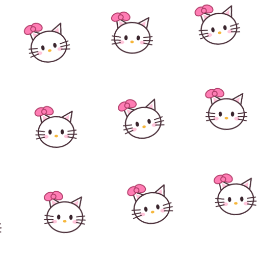

# Pink Bow Kitty

A soft, simple pink theme for [DeepSeek Harness](https://github.com/deepseek-ai/deepseek-harness).
一个粉嫩、简洁的 DeepSeek Harness 主题。

## About / 关于

**English.** Pink Bow Kitty is a soft, simple pink theme for DeepSeek Harness. It keeps the interface quiet and uncluttered: a hand-drawn kitty-print wallpaper, a gentle pink palette in both light and dark, and two small bow-wearing kitty mascots. There are no extra panels, no configuration, and no workflow changes — just a softer, friendlier Harness.

**中文。** 粉色蝴蝶结小猫是一个粉嫩、简洁的 DeepSeek Harness 主题。它让界面保持安静、克制：手绘小猫印花壁纸、浅色与深色两套柔和粉色，以及两只戴蝴蝶结的小猫装饰。没有额外面板，没有复杂配置，也不改变任何工作流——只是让 Harness 更柔和、更亲切。

## Features / 特点

- Soft pink palettes for light and dark / 浅色与深色两套柔和粉色
- Hand-drawn kitty-print wallpaper, softened with a pink veil so text stays readable / 手绘小猫印花壁纸，叠加粉色薄纱，文字仍然清晰
- Bow-wearing kitty mascots under the composer and on the welcome screen / 输入框下方与欢迎页的蝴蝶结小猫装饰
- No configuration, no extra panels, no workflow changes / 无需配置、没有额外面板、不改变工作流

## Install / 安装

This is a standard DSH bundle: `package.json` declares `dsh.bundle` and `dsh.client`, and `cordis.patch.yml` inserts the plugin row.

这是一个标准的 DSH bundle：`package.json` 声明 `dsh.bundle` 与 `dsh.client`，`cordis.patch.yml` 插入插件行。

- From the DSH plugin market: search for **Pink Bow Kitty** and install it from the Themes tab. / 在 DSH 插件市场搜索 **Pink Bow Kitty**，从主题页安装。
- Or install this repository as a bundle through the DSH plugin manager. / 或通过 DSH 插件管理器把本仓库作为 bundle 安装。

The theme applies immediately after the client plugin loads. Disable or remove the bundle to restore the stock UI exactly.

客户端插件加载后主题立即生效；停用或移除 bundle 即可完全恢复原生界面。

## Compatibility / 兼容性

Built against the DSH Web client's `theme` token-override service and the documented UI slots (`shell.overlay`, `conversation.composer.dock`, `conversation.hero.brand.mark`). No DeepSeek Harness client package is imported.

基于 DSH Web 客户端的 `theme` token 覆盖服务与公开 UI 插槽（`shell.overlay`、`conversation.composer.dock`、`conversation.hero.brand.mark`）实现；不导入任何 DeepSeek Harness 客户端包。

## Artwork / 素材

All artwork in this repository is original vector art drawn for this plugin: the kitty faces, the repeating wallpaper, and the plugin icon. No third-party characters or images are bundled.

本仓库的所有素材均为原创矢量绘制：小猫头像、循环壁纸与插件图标；不包含任何第三方角色或图片。

## Author / 作者

ZCFE327
